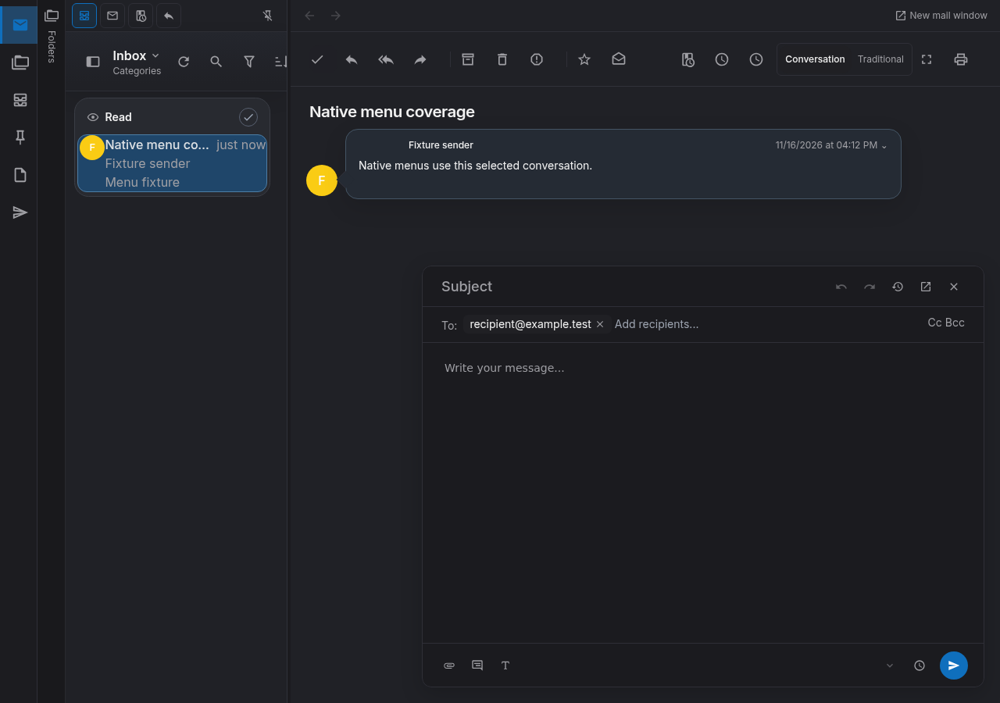
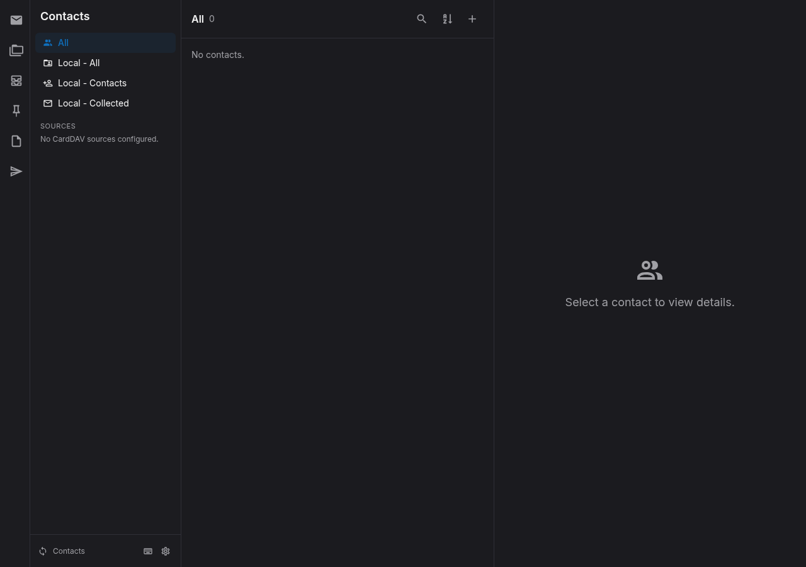

# Native task menus

File, Edit, View, Message, Mailbox, Format, Go, Window and Help share a fixed action catalog in `internal/nativemenu/catalog.json`. The application menu retains macOS standard commands. Event and Contact submenus are inside Message rather than extra top-level menus.

The native layer only emits an action ID and UI epoch. It cannot mutate mail or send a message directly. Frontend registrations call existing view handlers; `data-native-action` controls call the actual UI button. A disabled displayed control overrides any registered fallback. Permanent deletion stops at the existing confirmation dialog.

Availability comes from the active view, current selection, composer, source permissions and displayed controls. Repeated per-message, attachment or scheduled-delivery commands require a single target or the focused row. Ambiguous actions are disabled rather than applied to the first row. Dialogs exclude background actions. Semantic selection/context keys and target identities reject delayed clicks after a selection change; unrelated clocks and text updates do not discard valid clicks.

The main window, detached composer, detached reader and mail windows all install the bridge. Detached processes do not acquire commands belonging to the primary window. The four existing native editing accelerators remain registered; other shortcut labels are hints only and the existing context-aware keyboard handlers keep ownership.

## Coverage

- File: new mail/event/contact, Send and Send Later, scheduled mail, attachments, print, detach, close and new mail window.
- Edit: undo/redo and histories, clipboard, select all and search.
- View: Mail/Calendar/Contacts/Scheduled, panes, conversation display, themes, filters, sorting, grouping and calendar layouts.
- Message: replies, archive, later queues, snooze, read/star/spam/trash, folder moves/copies, image permissions, source/details, draft editing, calendar recognition, read receipts, event and contact actions.
- Mailbox: account/folder sync, saved searches, virtual folders, folder read state/pinning/download policy, empty trash, settings/source management and scheduled-delivery controls.
- Format: existing editor toolbar actions, identity, Cc/Bcc, quick replies, receipt and signing/encryption toggles. In the compact composer, Formatting Toolbar opens the toolbar before its controls become available.
- Go: message/folder/account/pane navigation, view cycling, check-selection commands, context menus and reader scrolling.
- Window: standard native Window menu.
- Help: shortcuts, command palette and What's New.

Settings and source-management entries open their existing dialogs; they do not create a second set of settings controls. Link-specific operations remain on the exact link's existing context menu, since a message selection alone is not an unambiguous link target. Ordinary text entry and dialog-specific form choices remain in their controls.

## Browser workflow captures

These show the actual frontend used in the dispatcher tests, not a native macOS menu.

## Verification boundary

Automated browser tests use a deterministic backend, not a live mailbox. They exercise all four frontend entry points, stale/disabled/ambiguous targets, modal isolation, editing, view switching, formatting and destructive-action confirmation. Go tests cover disabled startup, duplicate entries, stale states and preserved editing accelerators. Native macOS menu activation, shortcut-hint rendering, VoiceOver and packaged behavior still require an installed-app check.
